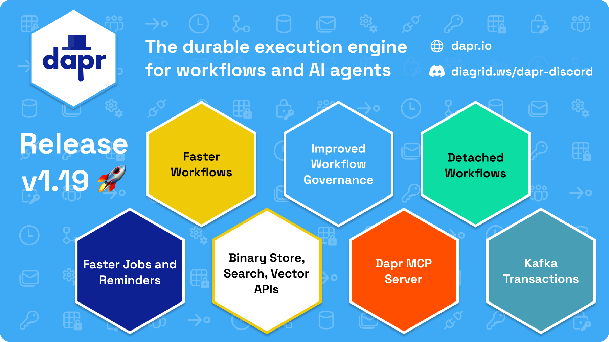

We're excited to announce Dapr 1.19! It lets the Scheduler serve actor placement, adds a Binary Store building block and alpha search and vector APIs, and sends workflow workers only the new history events of each turn. It also adds cross-app workflow operations and Kafka transactions, with changes across the runtime, the control plane, actors, components and the SDKs. The full list of issues and pull requests is in the [release notes](https://github.com/dapr/dapr/releases/tag/v1.19.0).

The main changes in this release:

- [Workflow performance](#workflow-and-runtime-performance): history deltas for workers, plus a `WorkflowsFastPath` preview feature.
- [Cross-app workflow operations](#workflow-operations-across-applications).
- [Access policy `requires`, detached workflows and `AlreadyExists`](#workflow-access-policy-requires-detached-workflows-duplicate-instance-ids-and-child-retries).
- [Placement served by the Scheduler](#placement-served-by-the-scheduler-opt-in), opt-in.
- [Binary Store building block](#binary-store-building-block-alpha), alpha.
- [Search and vector APIs](#search-and-vector-apis-alpha), alpha.
- [Dapr MCP server](#dapr-mcp-server-alpha-released-separately), alpha and released separately.
- [Actor timer and reminder APIs](#actor-timer-and-reminder-apis-timer-ownership-and-activation-id).
- [Image references in workload identity certificates](#image-references-in-workload-svids).
- [`appProtocol` on Kubernetes Services](#appprotocol-on-kubernetes-services).
- [Kafka pub/sub transactions](#kafka-pubsub-transactions).
- [Structured logging](#structured-logging-more-output-destinations-and-file-rotation).
- [Security fixes](#security-fixes).
- [Scheduler and metrics behavior changes](#scheduler-and-metrics-behavior-changes).

Read the [breaking changes](#breaking-changes) and [deprecation notices](#deprecation-notices) before you upgrade. 1.19 contains behavior changes that can affect an upgrade, mostly in the SDKs. The ones to check first:

- Helm users must apply the 1.19 CRDs before `helm upgrade`, otherwise the API server drops the new `requires` field of `WorkflowAccessPolicy`.
- The Scheduler now needs `get`, `list` and `watch` on `pods` in the Dapr namespace, even if you do not turn on Scheduler-served placement.
- Do not roll back from 1.19 directly to 1.17.6 or earlier. Go to 1.18.x, or through 1.17.7 first.
- The Python SDK extensions are now extras of the core `dapr` package, and the Java SDK requires Spring Boot 4.0.

If you're new to Dapr, visit the [getting started](https://docs.dapr.io/getting-started/) page and familiarize yourself with Dapr. The docs have been updated with all the new features and changes of this release. To get started with the new capabilities, go to the [concepts](https://docs.dapr.io/concepts/) and [developing applications](https://docs.dapr.io/developing-applications/) sections.

Go to the [upgrading Dapr](#upgrading-to-dapr-119) section for the steps to upgrade to 1.19.

## Acknowledgements

Thanks to everyone who made this release possible!

@acroca, @adam6878, @Advait2912, @anneheartrecord, @anxkhn, @arturotrenard, @baltasarblanco, @CasperGN, @cicoyle, @DamienCassou, @famarting, @gargsajal9, @GHX5T-SOL, @icmp0x8, @ihopenre-eng, @javier-aliaga, @jjcollinge, @jongep86, @JoshVanL, @jslatten, @kayvonkhosrowpour, @kshitizj03, @LiBaoxuan-Neil, @LilDojd, @LindseyZ1205, @lrascao, @m3nax, @magic-peach, @manduinca, @marcduiker, @matheusandre1, @mikeee, @MrMint, @MsfPablo, @mtaghavi2005, @Mukuwul, @MyMirelHub, @nelson-parente, @olitomlinson, @pablochacin, @passuied, @Psingle20, @pujitha24, @Rishabh-git10, @SaiPisey2, @SarthakB11, @seherv, @sicoyle, @siri-varma, @somaz94, @stywzn, @tezizzm, @vip892766gma, @WhitWaldo, @yaron2, @Yash121l

## Highlights

### Workflow

#### Stateful workflow worker stream (history deltas)

Before 1.19, a workflow worker received the full history of an instance on every turn. For long-running instances, sending and parsing that history took most of the time of each turn.

A [worker](https://docs.dapr.io/developing-applications/building-blocks/workflow/workflow-stateful-client/) can now advertise the `WORKER_CAPABILITY_STATEFUL_HISTORY` capability on its work-item stream. The worker then keeps the history of each instance in a cache. When the worker already has the history from an earlier turn on the same stream, the sidecar sends only the new events, and the worker builds the full history from its cache and the new events. On a reconnect, the sidecar sends the full history. If the worker has evicted the instance from its cache, it fetches the full history from the sidecar. Either case adds latency, but it does not change the result.

On an idle work-item stream, the sidecar now sends a health ping every 30 seconds to a worker that advertises the `WORKER_CAPABILITY_HEALTH_PING` capability. Load balancers such as AWS ALB and nginx close an idle stream after 60 seconds, and before 1.19 that cost the worker a reconnect and a full history resend. The 1.19 Python, Java and .NET SDKs and Go SDK 1.16 advertise the capability. Set `DAPR_WORKFLOW_HEALTH_PING_INTERVAL` on daprd to change the interval.

The SDKs that support stateful history turn it on by default:

- Python: on by default. Set `disable_stateful_history=True` on `WorkflowRuntime` to turn it off.
- Java: on by default. Call `WorkflowRuntimeBuilder.withStatefulHistoryDisabled(true)` to turn it off.
- .NET: on by default. Set `WorkflowRuntimeOptions.DisableStatefulHistory` to turn it off.
- Go: on by default from Go SDK 1.16.0 (durabletask-go v0.15.0). The Go SDK has no switch to turn it off, but `client.WithStatefulHistoryDisabled()` in durabletask-go does.
- JavaScript: no. The new JavaScript workflow engine does not use the shared DurableTask client library.

Because the worker keeps the history of each instance in memory, you can turn the cache off if worker memory is limited.

#### Workflow and runtime performance

Compared with the published v1.18.0 run, the nightly [performance tests](https://docs.dapr.io/operations/performance-and-scalability/) on the main branch show:

- Workflows: throughput is 40% higher in `TestWorkflowWithConstantVUs` and 32% higher in `TestSeriesWorkflowWithMaxVUs`.
- Jobs scheduling: p99 latency is 33% lower (39.5 ms to 26.3 ms), and the test now sustains the full requested 1000 QPS (921 QPS on 1.18.0).
- Actor reminder registration: p99 latency is 71% lower (148 ms to 43 ms), at 43% more registrations per second.
- Configuration subscribe: throughput is 67% higher over HTTP and about 2.8x over gRPC. This test varies up to 3x between runs, so treat the gRPC figure as indicative.

Service invocation, state and pub/sub publish show no change beyond run-to-run noise. The figures are medians of 8 runs from 23 September to 2 October 2026, on the same cluster as the v1.18.0 run. The 1.19 charts are published on the [performance results](https://docs.dapr.io/operations/performance-and-scalability/perf-results/) page.

Changes in this area include event-driven completion of work items, cached tag maps for metrics on hot paths, fewer state copies and event marshals per workflow turn, and a separate size and payload-ratio aggregation for each meter. Large fan-outs also got faster: a wake-up with an empty inbox reloads the workflow state only when its cache is stale, and a completed workflow no longer re-arms for duplicate late results. Before, each such wake-up re-read the whole history.

For workflows that run for minutes or hours, the `workflow` block of the metrics settings in `Configuration` now takes its own `latencyDistributionBuckets`, with a `latencyDistributionUnits` such as `1s`. The workflow and activity execution latency histograms then use buckets that fit those durations, instead of the shared millisecond buckets where every long workflow landed in the top bucket. The dapr/dapr repository also ships Grafana dashboards for workflows and for the Scheduler in its [`grafana/`](https://github.com/dapr/dapr/tree/release-1.19/grafana) directory. They chart execution and activity rates, latency percentiles, failures, client operations, and payload size against the limit. The etcd panels of the Scheduler dashboard need `--etcd-metrics=extensive`.

#### WorkflowsFastPath preview feature

The new [`WorkflowsFastPath`](https://docs.dapr.io/developing-applications/building-blocks/workflow/workflow-fast-path/) [preview feature](https://docs.dapr.io/operations/support/support-preview-features/) is off by default. With it, a workflow wake-up runs on the host that armed it, instead of going through a Scheduler reminder for each event. A repeating janitor reminder for each instance keeps the work durable.

To try it, enable the feature in your Dapr Configuration:

```yaml
spec:
  features:
    - name: WorkflowsFastPath
      enabled: true
```

The fast path stays off when a Scheduler-enforced [workflow or activity concurrency limit](https://docs.dapr.io/developing-applications/building-blocks/workflow/workflow-concurrency/) is configured, and daprd logs the reason. Fast-path drives run work items directly on the sidecar, so they would bypass the concurrency limit of the Scheduler.

#### Workflow operations across applications

Before 1.19, a workflow could start child workflows and activities in another app, but the client operations worked only on workflows of the calling app. Now a workflow client can run its operations on a workflow that [another app in the same namespace](https://docs.dapr.io/developing-applications/building-blocks/workflow/workflow-multi-app/) owns: start, get, raise event, pause, resume, terminate, purge and rerun. Listing instance IDs and reading history stay local. Use this when one app manages workflows that another app owns, for example an API or operations service that starts and inspects order workflows owned by the orders app, without registering those workflows itself.

The `WorkflowAccessPolicy` of the target app decides which operations a caller can do, per operation and per workflow name. The workflow request protos have a new optional `app_id` field, and the HTTP endpoints accept an `appID` query parameter. Rerun is available through the SDK workflow clients only. When no workflow worker is connected for the target app, local or remote, these operations now fail at once with a clear error, instead of a 20 second retry and an actor routing error (see the [breaking changes](#breaking-changes)).

#### Workflow access policy `requires`, detached workflows, duplicate instance IDs and child retries

- A [`WorkflowAccessPolicy`](https://docs.dapr.io/operations/security/workflow-access-policy/) rule can now have a `requires` block. The operation is then allowed only when the [propagated workflow history](https://docs.dapr.io/developing-applications/building-blocks/workflow/workflow-history-propagation/) of the caller contains the listed events. A rule can require proof that the caller saw a specific upstream event, instead of allowing the caller unconditionally. For example, a billing app can allow its `charge` activity only for callers whose history holds an `event.raised` named `order.validated` from the orders app, so a caller cannot skip the validation step. `requires` is an ordered list of up to 20 entries, each with `appID`, `eventType` (`activity.started`, `activity.completed`, `workflow.started`, `workflow.completed` or `event.raised`) and `name`. It applies to scheduling only: activity rules, or workflow rules whose only operation is `schedule`.
- A workflow can now start a [detached workflow](https://docs.dapr.io/developing-applications/building-blocks/workflow/workflow-detached/). A detached workflow is an independent instance, with no link to its parent and no result back to it. Use it when a workflow needs to start work that should outlive it, such as a clean-up or report job, without waiting for the result. Before 1.19, the workaround was a client call inside an activity. The .NET SDK supports detached workflows in 1.19, and in durabletask-go (used by Go SDK 1.16) the method is `WorkflowContext.ScheduleNewDetachedWorkflow`.
- [Scheduling through an SDK workflow client](https://docs.dapr.io/developing-applications/building-blocks/workflow/howto-manage-workflow/) fails with the gRPC `AlreadyExists` status code when the instance ID belongs to an active (not completed) instance. The sidecar has done this since 1.18.2. The error message does not change, so an SDK can detect the conflict without parsing the message, and a client can start a workflow with a fixed instance ID as an idempotent call and treat `AlreadyExists` as already running. A completed instance ID is reused by default. It also returns `AlreadyExists` when the client sets `WithEnforceUniqueInstanceID`, or when the old instance's child workflows have not finished. The Dapr runtime workflow API (HTTP and gRPC `StartWorkflowBeta1`) keeps its error response.
- A child workflow that runs as a retry attempt now records the instance ID of the first attempt in the parent's history. Each retry of a child workflow is a separate instance with its own ID, so tooling that reads a parent's history can now group the attempts of one call without walking the retry timers between them.

#### Workflow client operations in the SDKs

The SDK workflow clients pick up the new runtime capabilities:

- The Go, Java and Python workflow clients can list workflow instances, read the history of an instance and rerun a workflow from an event.
- The Java and Python workflow clients can run client operations on workflows in other apps.

See the [SDK improvements](#sdk-improvements) for the complete list per language, including detached workflows in .NET, the Java `WorkflowInstanceAlreadyExistsException`, and the client health ping, and the [breaking changes](#breaking-changes) for the SDK behavior changes that affect workflow code.

### Placement served by the Scheduler (opt-in)

The [Scheduler service](https://docs.dapr.io/concepts/dapr-services/scheduler/) can now serve actor placement. With this feature on, the Scheduler places actors itself, and it sends each actor reminder straight to the host that runs the actor. With the standalone [Placement service](https://docs.dapr.io/concepts/dapr-services/placement/), a reminder goes to any instance of the app, and that instance forwards it to the owner. The cluster also no longer needs the Placement service. The feature is off by default. Applications and sidecars need no configuration change.

Before you turn it on, upgrade every sidecar to 1.19 or later. An older sidecar can use only the Placement service. Once no Placement service remains, an older sidecar's actor and workflow APIs stall until you upgrade its pod, and the Scheduler logs a warning. The older sidecar does not stop the Scheduler from serving the upgraded sidecars.

To turn it on, set this Helm value, and pass it on every later `helm upgrade`, because Helm resets values you do not pass:

```yaml
global:
  scheduler:
    placement:
      enabled: true # default: false
```

How it works:

- The Helm chart does not deploy the Placement StatefulSet, Service or RBAC. It starts the Schedulers with `--placement-enabled=true`. The chart does not render unless `global.scheduler.enabled`, `global.actors.enabled` and `global.actors.serviceName=placement` are set.
- While a Placement service is still deployed, it stays the placement authority and the Schedulers do not serve placement. When the Placement pods are gone, the Schedulers detect it and take over within a few seconds. The Schedulers also restart to pick up the new flag in the same upgrade, so expect actor and workflow activity to pause for longer than that while the Schedulers come back up.
- You can turn the feature on or off without sidecar restarts. When you turn it off, the Placement service is redeployed and sidecars move back to it. Sidecars switch as soon as the Placement pod exists, so expect a short pause until it is ready.
- Actor state is not lost. The two services place actors differently, so actors are deactivated and reactivated on their new hosts once per switch, in either direction.
- The Scheduler needs `get`, `list` and `watch` on `pods` in the Dapr namespace to detect a Placement service. The chart adds this as the `dapr-scheduler-pods` Role. If you use custom RBAC, add it before any 1.19 upgrade.

To check which authority a sidecar uses, look for `Connected to scheduler placement leader <address>` in its log. The other authority logs `Connected to placement <address>`. In the Scheduler, the metrics `dapr_scheduler_placement_leader` and `dapr_scheduler_placement_streams_connected` show the leader and the connected sidecars, and `dapr_scheduler_placement_incapable_sidecars` counts sidecars older than 1.19.

There are new flags for this feature. daprd adds `--actors-placement-startup-timeout` (default 30s, with the annotation `dapr.io/actors-placement-startup-timeout`). The Scheduler adds `--placement-enabled`, `--placement-disseminate-timeout` (default 8s) and `--placement-disseminate-coalesce-window` (default 0). The two `--placement-disseminate-*` flags have no Helm value.

In self-hosted mode, use [`dapr init --scheduler-placement`](https://docs.dapr.io/reference/cli/dapr-init/). It is not available with `-k` or `--slim`. It does not start the `dapr_placement` container, and it starts `dapr_scheduler` with `--placement-enabled=true`.

Scheduler-served placement stays opt-in in 1.19. See the [deprecation notices](#deprecation-notices) for the proposed direction.

### Binary Store building block (alpha)

A new [building block](https://docs.dapr.io/developing-applications/building-blocks/binarystore/) stores files through one API, for content that is too large for a state store. You create a component of a `binarystore.*` type and call the [alpha API](https://docs.dapr.io/reference/api/binary_store_api/):

- HTTP: `/v1.0-alpha1/binarystore/{name}/{fileName}`. Use PUT or POST to write a file, GET to read it and DELETE to delete it.
- gRPC: `SetBinaryFileAlpha1` streams a file in, `GetBinaryFileAlpha1` streams it out, and `DeleteBinaryFileAlpha1` deletes it.

The components are:

- [`binarystore.aws.s3`](https://docs.dapr.io/reference/components-reference/supported-binarystores/binarystore-s3/) for Amazon S3 and S3-compatible stores
- [`binarystore.azure.blobstorage`](https://docs.dapr.io/reference/components-reference/supported-binarystores/binarystore-azure-blobstorage/)
- [`binarystore.azure.datalake`](https://docs.dapr.io/reference/components-reference/supported-binarystores/binarystore-azure-datalake/)
- [`binarystore.gcp.bucket`](https://docs.dapr.io/reference/components-reference/supported-binarystores/binarystore-gcp-bucket/)
- [`binarystore.oci.objectstorage`](https://docs.dapr.io/reference/components-reference/supported-binarystores/binarystore-oci-objectstorage/)
- [`binarystore.in-memory`](https://docs.dapr.io/reference/components-reference/supported-binarystores/binarystore-in-memory/), for tests

SDK support in 1.19 is .NET only, through the `Dapr.BinaryStore.Abstractions`, `Dapr.BinaryStore.Runtime` and `Dapr.BinaryStore.Generators` packages. The Go, Python, Java and JavaScript SDKs do not support it in 1.19, so call the HTTP or gRPC API directly. See the [Binary Store docs](https://docs.dapr.io/developing-applications/building-blocks/binarystore/) and the [.NET SDK docs](https://docs.dapr.io/developing-applications/sdks/dotnet/dotnet-binarystore/).

### Search and vector APIs (alpha)

Two new alpha building blocks give you portable APIs for full-text search and similarity search. The [search API](https://docs.dapr.io/developing-applications/building-blocks/search/search-overview/) indexes JSON documents in full-text search engines and queries them. The [vector API](https://docs.dapr.io/developing-applications/building-blocks/vector/vector-overview/) stores dense vectors (embeddings) and runs similarity queries. It is the storage and retrieval layer for patterns such as retrieval-augmented generation (RAG), semantic search and recommendations. You swap the underlying engine by changing the component.

Both APIs only store and query data that is ready to use. Your application does text extraction, chunking and embedding generation before it calls them. For RAG, you can pair the vector API with the [conversation API](https://docs.dapr.io/developing-applications/building-blocks/conversation/conversation-overview/) to send the retrieved context to an LLM.

The search API works on indexes of documents. A document has a caller-supplied `id`, a `content` JSON object that is indexed, and string `metadata` that is stored and returned unchanged but never indexed or filterable. Creating an index that already exists returns `ALREADY_EXISTS`, and Dapr never changes the settings of an existing index. Documents are written with a keyed upsert, so retrying a request is idempotent, and a document whose content is not a JSON object is reported in `failedItems` while the rest of the batch is indexed. A query is either a portable full-text query (`text`, optionally limited to `searchFields`) or a provider-native query (`native`) for engine-specific features. You can combine either with filters, sorting, highlighting, field projection and pagination through opaque continuation tokens. Hit scores are unnormalized and provider specific, so compare them only within one result set, and `totalHits` comes with a `totalHitsRelation` of `EXACT`, `LOWER_BOUND` or `ESTIMATE`.

The vector API works on collections with fixed `dimensions` and a distance metric: cosine similarity (-1 to 1, higher is closer), dot product (higher is closer) or Euclidean distance (lower is closer). `dimensions` is required when you create a collection. If you leave out `metric`, the component's default applies. A record has an `id`, the float `values` of the vector, `metadata` that you can filter on, and an opaque `payload` that is returned unchanged but never filterable. A query finds the `topK` records closest to a query vector or to the stored vector of an existing record (`byId`), and can set an inclusive `scoreThreshold` on the metric's own scale. A batch query runs several queries against one collection in a single call. Each query succeeds or fails on its own, and the response has one result per query in request order.

The two APIs share their filter language, write behavior, error handling and observability:

- Filters use comparison (`$eq`, `$ne`, `$gt`, `$gte`, `$lt`, `$lte`), set (`$in`, `$nin`), existence (`$exists`) and logical (`$and`, `$or`, `$not`) operators, with dotted paths for nested keys such as `customer.region`. Search filters address the document `content`, and vector filters address the record `metadata`.
- Many engines index asynchronously, so a write returns as soon as the engine accepts it (`INDEXING_MODE_RETURN_ON_ACCEPTANCE`, the default), or waits up to a `waitTimeout` for the final result (`INDEXING_MODE_WAIT_FOR_COMPLETION`). When you wait, you choose whether the write continues asynchronously or fails with `DEADLINE_EXCEEDED` at the timeout. The wait timeout must be shorter than the remaining call deadline and than the component's resiliency timeout.
- Errors from the engine keep their gRPC status code and details, also over HTTP. Errors that Dapr detects before calling the engine use `ERR_SEARCH_*` and `ERR_VECTOR_*` codes. Resiliency policies apply to calls to the engine, and a retried index or collection delete that returns `NOT_FOUND` is reported as successful.
- The metrics `dapr_component_search_count`, `dapr_component_search_latencies`, `dapr_component_vector_count` and `dapr_component_vector_latencies` are tagged by `operation`, and calls are traced.

In 1.19, Meilisearch is the only production engine, and the `search.in-memory` and `vector.in-memory` components are available for tests. The [`search.meilisearch`](https://docs.dapr.io/reference/components-reference/supported-search/meilisearch/) component supports full-text search, filtering, sorting, highlighting, offset-based pagination and native queries. Filters and sorts can only use attributes that you declare as filterable or sortable when you create the index. The [`vector.meilisearch`](https://docs.dapr.io/reference/components-reference/supported-vector/meilisearch/) component stores user-provided embeddings and supports cosine similarity only. Search indexes and vector collections share a Meilisearch instance, so the vector API works only on collections that have the `default` user-provided embedder.

The APIs are available over HTTP (`/v1.0-alpha1/search` and `/v1.0-alpha1/vector`) and gRPC. The SDKs don't support them yet, so call the API directly. See the [search API reference](https://docs.dapr.io/reference/api/search_api/), the [vector API reference](https://docs.dapr.io/reference/api/vector_api/), and the how-to guides for [searching](https://docs.dapr.io/developing-applications/building-blocks/search/howto-search/) and [storing and querying vectors](https://docs.dapr.io/developing-applications/building-blocks/vector/howto-vector/).

### Dapr MCP server (alpha, released separately)

The [Dapr MCP server](https://docs.dapr.io/developing-ai/mcp/dapr-mcp-server/) ([`dapr/dapr-mcp-server`](https://github.com/dapr/dapr-mcp-server)) is a standalone [Model Context Protocol](https://modelcontextprotocol.io/) server, written in Go, that runs next to a Dapr sidecar and turns its building blocks into MCP tools. Any MCP client can call them, such as Claude Desktop, Cursor, Claude Code, VS Code, [Dapr Agents](https://docs.dapr.io/developing-ai/dapr-agents/), or your own agent.

It is not part of the Dapr runtime and is not tied to this release. It is a separate binary in its own repository, with its own version numbers and release cycle, and it is in alpha, so tool names, inputs and configuration can still change. It appears here because its documentation shipped with the 1.19 docs.

How it works:

- The server connects to the sidecar over gRPC with the usual settings, `DAPR_GRPC_PORT` and `DAPR_GRPC_ENDPOINT`. It retries five times, then exits.
- It reads the sidecar's metadata and registers tools for every building block that has at least one component loaded. The tools `get_components`, `invoke_service` and `invoke_actor_method` are always registered.
- It serves MCP over stdio by default, for clients that launch it themselves, or over streamable HTTP with `--http`. Authentication, health endpoints and CORS apply to the HTTP transport only.
- Tools follow component hot reloading. Adding the first component of a type registers that type's tools, removing the last one takes them away, and connected clients are told that the list changed. A client that reads the tool list only once has to reconnect to see the change.

The tools cover state (including transactions), pub/sub, output bindings, secrets, service invocation, actors, distributed lock, cryptography and conversation. Each tool carries the MCP safety annotations `readOnlyHint`, `destructiveHint` and `idempotentHint`.

Authentication is off until you set `AUTH_MODE`, which takes `oidc`, `spiffe`, `dapr-sentry` or `hybrid`. Turn it on whenever you serve over HTTP to anything other than localhost. The server can reach whatever its sidecar can reach, and it returns tool results to the model, including the values from `get_secret` and `get_bulk_secrets`. Scope its components and secrets to what the agent needs.

Telemetry is off until you set an OTLP endpoint. Over HTTP the server also serves `/livez`, `/startupz` and `/readyz` health endpoints.

### Actor timer and reminder APIs, timer ownership and activation ID

Actors have new APIs to read their [timers and reminders](https://docs.dapr.io/developing-applications/building-blocks/actors/actors-timers-reminders/):

- gRPC: [`ListActorTimers` and `GetActorTimer`](https://docs.dapr.io/reference/api/actors_api/).
- HTTP: `GET /v1.0/actors/{actorType}/{actorId}/timers` and `GET /v1.0/actors/{actorType}/{actorId}/timers/{name}`.
- HTTP: `GET /v1.0/actors/{actorType}/{actorId}/reminders`, to match the gRPC `ListActorReminders` API.

Before 1.19, timers could not be read back at all, and reminders could be listed only over gRPC. Use the new APIs to check why a timer did not fire, or to build tooling that shows what an actor has scheduled.

When an actor moves to another host, its in-memory timers on the old host are now deleted. Before 1.19, the old host kept firing them, and the actor ran twice when the timer was registered again on the new host. A timer operation sent to a host that does not own the actor now fails with `ERR_ACTOR_TIMER_NOT_OWNED` (HTTP 403, gRPC `PermissionDenied`). A timer fire that was parked during a placement change, and whose timer the ownership sweep deleted, is dropped and counted in `timers_dropped_total`.

daprd now sends a `Dapr-Actor-Activation-Id` header on the invoke, reminder and timer callbacks to the app, and the same key as metadata on the gRPC actor callback stream. The ID is new each time daprd activates the actor, so an SDK can drop an actor object it kept from an earlier activation instead of reusing its cached state. That happens, for example, when daprd deactivates the actor on its idle timeout and activates it again on the same host. No SDK uses the header in 1.19.

### Image references in workload SVIDs

Workload identity certificates now record which images run in the pod. A consumer can use this to link an mTLS identity or an attestation record to the exact image that ran. For example, it can find the workloads that run an image with a known CVE.

On Kubernetes, [Sentry](https://docs.dapr.io/concepts/dapr-services/sentry/) now adds the image references of the requesting pod's containers (the app containers and daprd) to the [workload identity certificate](https://docs.dapr.io/operations/security/mtls/). Sentry stores them in a non-critical X.509 extension, as a list with one entry per container: the image as written in the pod spec and, when the container has already started, its digest. Sentry takes the image data from the pod object that the Kubernetes validator already reads, through its pod cache or the API server, not from the request. The pod cache now holds only pods with the `dapr.io/sidecar-injected` label.

### `appProtocol` on Kubernetes Services

Every [Kubernetes Service](https://docs.dapr.io/operations/hosting/kubernetes/) that Dapr creates now sets `appProtocol` on each port. This includes the control-plane Services of the Helm chart and the sidecar Service that the operator creates for each app. A service mesh such as Istio can then select the protocol from this field instead of protocol sniffing. Ports that carry gRPC inside Dapr mTLS are declared `tls`, not `grpc`, so a mesh does not read the encrypted bytes as plain HTTP/2.

### `--healthz-listen-address` and `--metrics-listen-address` now take effect

The [control-plane binaries](https://docs.dapr.io/concepts/dapr-services/) (Placement, Scheduler, Sentry, injector and operator) have a `--healthz-listen-address` flag, but the shared healthz server ignored it and always bound all interfaces. The flag now takes effect. Sentry, the injector and the operator also honor `--metrics-listen-address` for their metrics server. The defaults are unchanged. Set a flag to a specific address to avoid start-up failures on hosts where a wildcard bind on the port conflicts with another process or interface.

### Security fixes

Four security fixes for service invocation, the Scheduler and workflows also shipped in 1.18.6. Three of them change behavior, and the [breaking changes](#breaking-changes) describe them: the caller identity headers now come from the sidecar, some encoded service invocation methods now fail, and the actor invoke API rejects reserved actor types. The fourth fix does not change behavior.

<!-- EDITOR: name the fourth security fix here, if the maintainers want it listed. The release notes draft does not say what it is. -->

### Kafka pub/sub transactions

[Kafka pub/sub](https://docs.dapr.io/reference/components-reference/supported-pubsub/setup-apache-kafka/) adds transactions. All three modes are off by default:

- `producerTransactionsEnabled`: every publish, single or bulk, runs in a Kafka transaction on an idempotent producer. A bulk publish is then atomic: all entries commit or none do. The guarantee is atomicity per publish, and there is no transaction recovery or fencing across component restarts. The mode needs `producerRequiredAcks: "all"`, `producerRetryMax` of 1 or more, and Kafka 0.11 or later. It lowers publish throughput.
- `consumerIsolationLevel: "read_committed"`: a subscription reads only committed records. It never sees records from open or aborted transactions.
- `consumerTransactionsEnabled`: each delivery runs inside a transaction (consume-transform-produce). The outputs of a delivery and its offset commit together, and failed attempts are invisible to `read_committed` consumers. Side effects outside Kafka, such as database writes, are not covered. The mode needs a consumer group, the same `producerRequiredAcks` and `producerRetryMax` settings, and Kafka 2.5 or later.

### Components

Pub/sub:

- RabbitMQ supports externally managed and consistent-hash exchanges. Two new metadata options, [`exchangeDeclareMode` and `queueDeclareMode`](https://docs.dapr.io/reference/components-reference/supported-pubsub/setup-rabbitmq/), each take `declare` (the default) or `passive`. In `passive` mode, the component expects the exchange or queue to already exist, instead of creating it. The component also accepts the `x-consistent-hash` exchange kind, for hash-based partitioning across queues.
- The [AMQP 1.0 component](https://docs.dapr.io/reference/components-reference/supported-pubsub/setup-amqp/) now also registers as `pubsub.amqp`, a generic form with no vendor-specific address prefix, so it works against any AMQP 1.0 broker. `pubsub.solace.amqp` keeps its original `topic://` and `queue://` prefixes, and existing Solace components keep working unchanged. In the same change, `anonymous` is now honored over `amqps://`, so a client certificate can be the only credential (mutual TLS without a username and password). Publishing with `ttlInSeconds` no longer panics the sidecar, a lost connection reconnects with backoff, and a failed link no longer closes the shared connection. Subscriptions can set `subscriptionName`, `durable`, `shared` and `selector`, so a named subscription can be durable, shared across replicas and filtered by the broker. The new component settings are `containerID`, `durableMessages` and `applicationPropertiesFromMetadata`.
- Kafka pub/sub and the Kafka binding get connection timeouts and producer settings. The new metadata options are [`dialTimeout`, `readTimeout` and `writeTimeout`](https://docs.dapr.io/reference/components-reference/supported-pubsub/setup-apache-kafka/) (30 seconds each), `metadataTimeout` (0, which is off), `producerRequiredAcks` (`all`, `local` or `none`, default `all`) and `producerRetryMax` (default 5). The defaults are the values the component used before, so an existing configuration does not change. The same options apply to the [Kafka binding](https://docs.dapr.io/reference/components-reference/supported-bindings/kafka/).

Secret stores:

- HashiCorp Vault supports native Kubernetes authentication. Set [`vaultAuthMethod: kubernetes`](https://docs.dapr.io/reference/components-reference/supported-secret-stores/hashicorp-vault/), and the component logs in to Vault with the pod's service account token. It no longer needs the Vault Agent Injector sidecar to get a token. `vaultAuthMethod: token` works as before.

Conversation:

- A [Conversation API](https://docs.dapr.io/reference/api/conversation_api/) request can now cap how many tokens a call generates. Set `max_tokens` on the request, or `maxTokens` in the component metadata as a default. A request value greater than zero overrides the metadata default.
- The [OpenAI component](https://docs.dapr.io/reference/components-reference/supported-conversation/openai/) can use the Responses API. Set `useResponsesAPI: "true"` in the component metadata, and the component calls `/v1/responses` instead of Chat Completions. Reasoning models that reject function tools on Chat Completions can then call tools. The setting is off by default, and it does not work with `apiType: azure`.

### Structured logging: more output destinations and file rotation

The control-plane binaries and daprd take six new [logging](https://docs.dapr.io/operations/observability/logging/) flags:

- `--log-outputs`: a comma-separated list of log destinations (`stdout`, `stderr`, or a file path). It merges with `--log-file`, so an existing `--log-file` configuration is unchanged.
- `--log-file-max-size`, `--log-file-max-backups`, `--log-file-max-age` and `--log-file-compression`: rotation for file destinations. Without them, a file destination is a plain file that grows with no limit.
- `--log-timestamp-format`: a Go time layout for the log timestamp. The default, RFC3339 with nanoseconds, stays unless you set this flag.

All six flags default to off or empty, so a binary that sets none of them behaves as before. When rotation is on and no size is set, a file rotates at 100 MB. The sidecar injector has no annotation for these flags.

### Scheduler and metrics behavior changes

- The [metrics server](https://docs.dapr.io/operations/observability/metrics/) answers only GET and HEAD. Other methods get 405. Prometheus scrapes are not affected.
- The [Scheduler](https://docs.dapr.io/concepts/dapr-services/scheduler/) keeps 10,000 etcd revisions instead of 1,000,000. Every revision keeps the payload of the job it wrote, and in one 15-hour chaos test the old value produced a 2.7 GB database and 3.4 GB of memory use for 19 MB of live jobs. A value that you set yourself is not changed, and `helm upgrade --reuse-values` keeps the old value.
- The Scheduler now retries in the process when its embedded store is briefly unavailable, instead of exiting. A port bind failure is the exception, and the process still exits.

The [breaking changes](#breaking-changes) describe all three in detail.

## SDK improvements

### Go SDK

The [Go SDK](https://docs.dapr.io/developing-applications/sdks/) can now host actors over gRPC. The app receives actor invoke, reminder, timer and deactivate callbacks on one bidirectional stream (`SubscribeActorEventsAlpha1`), so it does not need an HTTP callback server. This uses the runtime feature that shipped in 1.18.

For workflows, the workflow client lists instances, reads the history of an instance and reruns a workflow from an event (`ListInstanceIDs`, `GetInstanceHistory` and `RerunWorkflowFromEvent`). A new example and a section in the client guide show how to use them.

`WorkflowContext.Select` waits for the first of several tasks to complete and returns its index. It's the `WhenAny` that the other SDKs already had, from durabletask-go v0.15.0, which Go SDK 1.16 pins. Use it for an approval gate that waits for `Approve`, `Reject` or a timeout timer, whichever comes first. Before, the only way was to poll each event with short `WaitForSingleEvent` timeouts, and every poll added a timer and a history entry, so a workflow parked at a gate grew its history without bound. `Select` adds no timers or history entries, and the losing tasks stay pending to be awaited or selected later.

The workflow worker supports stateful history and turns it on by default. See the [stateful workflow worker stream](#stateful-workflow-worker-stream-history-deltas) for how to turn it off.

### .NET SDK

- Workflows: detached workflows and a health ping on the client stream.
- Workflows: the worker supports stateful history, on by default. See the [stateful workflow worker stream](#stateful-workflow-worker-stream-history-deltas) for the opt-out.
- Binary Store (alpha): the new `Dapr.BinaryStore.*` packages give .NET apps a client for the Binary Store building block, and an example project shows how to use it.
- Workflows: data references through the Binary Store, in the new `Dapr.Workflow.BinaryStore` project.
- The SDK supports .NET 11 (preview).
- Actors.Next: state caching follows an updated algorithm, and two registration fixes cover duplicate subscription descriptors and apps with several hosted services.
- Already released in 1.18.x: the .NET SDK ships from its main branch, so some of its 1.19 work was released in 1.18.x patches. The `Dapr.Actors.Next` package family and its reminder failure policies came in 1.18.5. Jobs with a timezone, a gRPC transport, purge and list, and per-actor-type configuration overrides for Actors.Next came in 1.18.6. The Dapr.Messaging implementation came in 1.18.8. Actor reentrancy fixes and faster state writes came in 1.18.9 and 1.18.10. They are not new in 1.19.

### Python SDK

- Workflows: the worker supports stateful history, on by default. See the [stateful workflow worker stream](#stateful-workflow-worker-stream-history-deltas) for the opt-out. To tune the cache, use `history_cache_ttl`, `history_cache_max_instances` and `history_cache_max_bytes`.
- Workflows: client operations on workflows in other apps, list, history and rerun operations on the workflow client, and a health ping on the client stream.
- Workflows: orchestrator work items run on their own thread pool. Before, sync activities that schedule workflows could take every thread and deadlock the worker.
- Workflows: the worker recovers after a host sleep or network change leaves its sidecar connection half-open. Results of work items that run across a reconnect are sent on the new connection, so the sidecar no longer re-runs those activities.
- Workflows: `when_all` waits for every task before it reports the first failure.
- Workflows: workflow gRPC channels honor `DAPR_GRPC_MAX_INBOUND_MESSAGE_SIZE_BYTES` for sending and receiving, so payloads over 4 MiB no longer fail with `RESOURCE_EXHAUSTED`. You can also pass `max_grpc_message_length` to `WorkflowRuntime` and to the sync and async `DaprWorkflowClient`.
- Actors: with reentrancy on, reminders, timers and activation no longer read stale state after a reentrant call saves it. Actor state also needs fewer state store reads, because missing keys are cached and setting state skips the existence check.
- Pub/sub: per-message metadata in bulk publish (`publish_events`) through the new `BulkPublishEntry` type, exported from `dapr.clients`.
- Pub/sub: a streaming subscription returns the next message after a reconnect instead of `None`. `next_message()` and iteration now raise the new `StreamReconnectError` after five failed reconnects. See the [breaking changes](#breaking-changes).
- Pub/sub: several wildcard subscriptions can be registered when topic validation is disabled.
- Configuration: `DAPR_*` environment variables are read when a setting is used, not when `dapr` is imported, so variables set later, for example by python-dotenv, take effect.
- Clients: each sidecar health check attempt has its own timeout within `DAPR_HEALTH_TIMEOUT`. A port that accepts connections but never replies no longer blocks client creation.
- Clients: absolute unix socket endpoints such as `unix:///tmp/dapr.sock` work for `DaprClient`, `WorkflowRuntime` and `DaprWorkflowClient`.
- Clients: on macOS, the SDK sets `GRPC_DNS_RESOLVER=native` when you have not set it, which fixes "DNS query cancelled" errors.
- Legacy `http://` and `https://` gRPC endpoints now emit a `DeprecationWarning`. See the [deprecation notices](#deprecation-notices).
- New extensions: durable RAG, and durability for Databricks Lakeflow.
- The extensions are now extras of the core `dapr` package. See the [breaking changes](#breaking-changes).

### Java SDK

- Workflows: the worker supports stateful history, on by default. See the [stateful workflow worker stream](#stateful-workflow-worker-stream-history-deltas) for the opt-out.
- Workflows: client operations on workflows in other apps, list, history and rerun operations, and a health ping on the client stream.
- Workflows: a `WorkflowInstanceAlreadyExistsException` when you schedule a workflow with the instance ID of an active instance.
- `WorkflowRuntime.close()` no longer blocks on an open work-item stream.
- Workflows: the worker calls the sidecar's `Hello` RPC every 30 seconds, so load balancers that ignore HTTP/2 PING frames, such as AWS ALBs, do not close the idle work-item stream. It is on by default. Set `dapr.workflows.runtime.app.keep.alive.enabled` to `false` to turn it off, or change the interval with `dapr.workflows.app.keep.alive.interval.seconds`.
- Actors: timers and reminders take a number of repetitions and a TTL. Bulk subscriptions trace each entry.
- Spring Boot 4.0 support. See the [breaking changes](#breaking-changes).
- Testcontainers: build the Dapr `Configuration` resource in code, with mTLS, logging, metrics, name resolution, components, secrets and an HTTP pipeline. A `Subscription` takes `scopes`, and `DaprContainer` gets default settings for Spring Boot apps.

### JavaScript SDK

There is no JavaScript SDK release for 1.19 yet (no release candidate and no 3.19 tag). These changes ship in the next JavaScript SDK release.

- A new workflow engine. The SDK no longer depends on the shared DurableTask client library, so it does not support stateful history in this release.
- Workflow retry policies.
- A replay-safe logger for workflow code.

## Upgrading to Dapr 1.19

To upgrade to this release of Dapr, follow the steps below to ensure a smooth upgrade. The full list of issues and pull requests is in the [release notes](https://github.com/dapr/dapr/releases/tag/v1.19.0).

### Local machine / self-hosted

1. Uninstall Dapr with the CLI you currently have installed, using `dapr uninstall --all`. This removes the default `$HOME/.dapr` directory, the binaries, all the `dapr_redis`, `dapr_placement`, `dapr_scheduler` and `dapr_zipkin` containers, and the `dapr_scheduler` volume. Linux users need to run `sudo` if the `docker` command needs it.
2. Download the latest release from the [CLI releases](https://github.com/dapr/cli/releases) and put the `dapr` binary in your `PATH`.
3. Run `dapr init --runtime-version=1.19.0`. Use the full version, because the CLI puts the version string into download URLs, so a short form such as `1.19` does not resolve. [`dapr init`](https://docs.dapr.io/reference/cli/dapr-init/) without `--runtime-version` installs the newest GA runtime, never a release candidate.
4. Check that both versions are 1.19.0 with `dapr --version`.

To serve actor placement from the Scheduler on a [self-hosted machine](https://docs.dapr.io/operations/hosting/self-hosted/self-hosted-upgrade/), run `dapr init --scheduler-placement`. The flag is for self-hosted mode only and needs runtime 1.19 or later. `dapr run` needs no change.

### Kubernetes

You can perform [zero-downtime upgrades](https://docs.dapr.io/operations/hosting/kubernetes/kubernetes-upgrade/) using both Helm 3 and the Dapr CLI.

#### Upgrade with the CLI

Download the latest CLI release and run `dapr upgrade --runtime-version 1.19.0 -k`. [`dapr upgrade`](https://docs.dapr.io/reference/cli/dapr-upgrade/) works on Kubernetes only, and both `-k` and `--runtime-version` are required. It also applies the updated CRDs when you pass the full version, but it skips them on a downgrade.

The CLI keeps high availability mode when it finds a control plane service with more than one replica. To turn HA mode on during the upgrade, pass the chart value with `--set global.ha.enabled=true`, because `dapr upgrade` has no `--enable-ha` flag (only `dapr init` has it). Other chart values you set before are reset to their defaults, so pass them again with `--set`. Wait until the operation is finished and check your status with [`dapr status -k`](https://docs.dapr.io/reference/cli/dapr-status/).

#### Upgrade with Helm

Dapr 1.19 updates two CRDs: `Configuration` (new workflow latency-bucket fields in the metrics settings) and `WorkflowAccessPolicy` (the new `requires` field). `helm upgrade` does not update CRDs, so apply them first, using the `configuration.yaml` and `workflowaccesspolicy.yaml` files from the `charts/dapr/crds` directory of the v1.19.0 tag in the dapr/dapr repository. If you upgraded from 1.17 with Helm and did not apply the 1.18 CRDs, also apply `mcpservers.yaml` from the same directory.

Then update your Helm repository and run `helm upgrade dapr dapr/dapr --version 1.19.0 --namespace=dapr-system --wait`. To upgrade with high availability mode, add `--set global.ha.enabled=true`. Wait until the operation is finished and check your status with `dapr status -k`.

With either method, make sure your deployments are restarted to pick up the latest version of the Dapr sidecar.

If you manage the RBAC of the Dapr control plane outside the Helm chart, grant the Scheduler `get`, `list` and `watch` on `pods` in the Dapr namespace (the chart's `dapr-scheduler-pods` Role), in addition to its `namespaces` permission. The Scheduler uses this to detect whether a Placement service is deployed. It needs the permission on every 1.19 upgrade, whether or not you turn on Placement served by the Scheduler. The Helm chart and `dapr upgrade -k` apply it for you.

#### Fresh install

See [how to deploy Dapr on a Kubernetes cluster](https://docs.dapr.io/operations/hosting/kubernetes/kubernetes-deploy/) for a complete guide. You can install with Helm 3 (`helm install dapr dapr/dapr --version 1.19.0 --namespace dapr-system --wait`, after creating the `dapr-system` namespace), or with the CLI (`dapr init --runtime-version=1.19.0 -k`). Afterwards, check that the control plane pods are running and healthy with `dapr status -k`, and run a rolling restart of your deployments (`kubectl rollout restart deploy/<deployment-name>`) to pick up the new sidecar version.

#### Opt in to Placement served by the Scheduler

The opt-in Helm value `global.scheduler.placement.enabled` (default `false`) makes the Scheduler serve actor placement, instead of the standalone Placement service. Follow these steps:

1. Prerequisites. Upgrade every sidecar to 1.19 or later first, and restart your applications after the control plane upgrade. If you use custom RBAC, make sure the Scheduler can get, list and watch `pods` in the Dapr namespace. Keep `global.scheduler.enabled`, `global.actors.enabled` and `global.actors.serviceName=placement` as they are, because the chart fails to render without them.
2. Enable. Run `helm upgrade` with `--set global.scheduler.placement.enabled=true` and your usual values. Pass the value on every later `helm upgrade`, because Helm resets values you do not pass. With the CLI, `dapr upgrade -k --runtime-version 1.19.0 --set global.scheduler.placement.enabled=true` passes the same value. `dapr upgrade -k` resets values you do not pass, so include it on every later CLI upgrade too. The upgrade removes the Placement StatefulSet, and the Schedulers start serving placement a few seconds after the last Placement pod is gone. The Schedulers also restart to pick up the new flag in the same upgrade, so expect actor and workflow activity to pause for longer than that while they come back up. No sidecar restarts are needed. Actors are re-placed once, and their state is kept.
3. Verify. Sidecars log `Connected to scheduler placement leader <address>`, and exactly one Scheduler reports `dapr_scheduler_placement_leader` = 1. If `dapr_scheduler_placement_incapable_sidecars` is above 0, or a Scheduler logs "A sidecar running an older Dapr version is connected", upgrade those pods, because their actor and workflow APIs stall.
4. Roll back. Upgrade with the value set to `false`. The Placement StatefulSet is redeployed, the Schedulers stop serving, and sidecars switch back to the Placement service without restarts. Actors are re-placed once more, and there is a short pause until the Placement pods are ready.

All Scheduler replicas must run with the same setting, which the chart ensures. See [placement served by the Scheduler](#placement-served-by-the-scheduler-opt-in) for how an older sidecar behaves.

## Downgrading to earlier versions

Do not roll back from 1.19 directly to 1.17.6 or earlier. The safe rollback target is 1.18.x.

Dapr 1.19 still issues the Ed25519 workload identity keys that Dapr 1.18 introduced, and [Sentry](https://docs.dapr.io/concepts/dapr-services/sentry/) persists the Ed25519-keyed CA into the `dapr-trust-bundle` secret. Versions of Sentry before 1.17.7 cannot parse this bundle and crash on startup with `unsupported key type ed25519.PrivateKey`. When Sentry is down, no new [workload certificates](https://docs.dapr.io/operations/security/mtls/) can be issued. Existing sidecars with unexpired certificates keep working, but any sidecar restart or certificate expiry fails to obtain a new identity. Dapr 1.19 does not change this floor from 1.18.

| From | To | Result |
|---|---|---|
| 1.19 | 1.18.x | Safe. 1.18 and 1.19 write the same trust bundle format. |
| 1.19 | 1.17.7 or later | Safe. 1.17.7 backports the Ed25519 PEM-decoder fix so Sentry can read the trust bundle as-is. |
| 1.19 | 1.17.6 or earlier | Sentry crash-loops at startup. Do not attempt this rollback. |
| 1.17.6 or earlier | 1.19 | Safe. Sentry accepts CSRs of any algorithm, and existing ECDSA P-256 bundles are read transparently, as in 1.18. |

If you must downgrade below 1.17.7, go through 1.17.7 first:

1. Roll the control plane back to 1.17.7. It includes the Ed25519 parsing fix and is the earliest version that can read a trust bundle written by 1.18 or 1.19.
2. Allow Sentry to stabilize and confirm that `dapr status -k` is healthy.
3. From 1.17.7, downgrade to your target version. You may want to rotate the CA first to an algorithm the target version generates natively. See your Sentry CA rotation runbook.

To roll back the control plane, use Helm rollback (preferred, with `helm history` to list the revisions) or re-install at the target version. After the control plane is back, run a rolling restart of your application Deployments so sidecars pick up the older injector image and re-issue their identities against the rolled-back Sentry.

Going from 1.19 to 1.18.x or to 1.17.7 does not require manual CA rotation. The Ed25519-keyed bundle remains valid, 1.17.7 reads it, and it keeps issuing new CSRs against the existing trust anchor. Only rotate the CA again if your downgrade target is below 1.17.7 or if your security posture requires it.

### If you turned on Placement served by the Scheduler

If you turned on `global.scheduler.placement.enabled`, turn it off before you downgrade, in this order:

1. Set the value to `false` with `helm upgrade` and wait for the Placement pods to be ready. Sidecars then use the redeployed Placement service, with no restarts.
2. Verify that your sidecars reconnect to the Placement service. They log `Connected to placement <address>`.
3. Downgrade the control plane.
4. Downgrade the sidecars, with a rolling restart of your applications.

Turning the value off first is safe and sufficient. A 1.18 sidecar that starts while no Placement service is deployed has no placement, and its actor and workflow APIs stall. A `helm rollback` to a revision from before you turned the value on restores the Placement StatefulSet in the same operation.

### If you created `WorkflowAccessPolicy` rules that use `requires`

A 1.18 control plane and sidecar do not know the `requires` field and apply those rules without the gate. Remove or narrow those rules before you downgrade.

## Breaking changes

Review these carefully before upgrading. The changes below can require action when you upgrade from 1.18 to 1.19. The Dapr runtime API changes in 1.19 are additive, so most items are behavior changes or SDK changes.

### Dapr runtime and Kubernetes

- Helm upgrades: apply the 1.19 CRDs first. `helm upgrade` does not update CRDs. Until the 1.19 `WorkflowAccessPolicy` CRD is applied, the API server drops the new [`requires`](https://docs.dapr.io/operations/security/workflow-access-policy/) field, so a rule written with `requires` applies without that gate.
- The Scheduler gets read access to pods in the Dapr namespace. The chart adds a `dapr-scheduler-pods` Role and RoleBinding in the Dapr namespace that give the [Scheduler](https://docs.dapr.io/concepts/dapr-services/scheduler/) `get`, `list` and `watch` on `pods`. The Scheduler watches the Placement pods in its own namespace to detect whether a Placement service is deployed, and it needs this whether or not you turn on Placement served by the Scheduler. The `dapr-scheduler` ClusterRole (or Role, in namespaced RBAC mode) keeps `namespaces` only. The Helm chart applies this on upgrade. If you manage RBAC outside the chart, or run policy checks against minimal RBAC scopes, account for the new Role.
- Dapr Kubernetes Services set `appProtocol`. Every port of every [Service](https://docs.dapr.io/operations/hosting/kubernetes/) that Dapr creates now declares `appProtocol` (`http`, `grpc`, `tls`, `https` or `tcp`). A service mesh that selects proxy behavior from this field can now treat these ports differently. Ports that carry gRPC inside Dapr mTLS are declared `tls`.
- Workflow: no `output` for a failed workflow. The [workflow Get API](https://docs.dapr.io/reference/api/workflow_api/) no longer copies the failure message into `dapr.workflow.output` for a workflow in the `FAILED` state. Read `dapr.workflow.failure.error_message` and `dapr.workflow.failure.error_type` instead.
- The Scheduler retries instead of exiting. When the Scheduler server stops with a runtime error, for example because its embedded store is briefly unavailable, the Scheduler now recreates it in the process with a jittered backoff from 500 ms up to 10 s, and its healthz endpoint reports not ready in the meantime. For these errors, it no longer exits and restarts, so alerts that count Scheduler pod restarts no longer see this condition. Use readiness or the logs instead.
- The Scheduler exits when it cannot bind its port. The retry in the previous item does not apply to a bind failure. The Scheduler process exits, and Kubernetes restarts it, as in 1.18, so alerts that count Scheduler pod restarts still see this condition. The Scheduler port, 50006, is inside the default Linux ephemeral port range, so one of the process's own outbound connections can hold it. daprd now binds its internal gRPC port (default 50002) once, before it connects to Sentry, the operator and the Schedulers, and keeps it across SIGHUP reloads.
- The Scheduler keeps 10,000 etcd revisions, not 1,000,000. The embedded etcd of the Scheduler compacts by revision count. The default retention drops from `1000000` to `10000`, both for the flag `--etcd-compaction-retention` and for the Helm value `dapr_scheduler.etcdCompactionRetention`, and the compaction mode stays `revision`. Every revision of a deleted job keeps the job's payload until it is compacted, so the old default kept the payloads of the last million writes. After 15 hours of chaos testing, that was 2.7 GB of database and 3.4 GB of Scheduler memory, for 19 MB of live jobs. On the 1Gi volume that clusters installed before 1.17.7 keep, the database filled the disk and etcd writes failed. The database now holds at most 10,000 revisions plus 5 minutes of writes. The retention bounds the number of revisions, not their size. A value that you set yourself is not changed, and `helm upgrade --reuse-values` keeps the old `1000000`, so pass the new value or drop the override. A Scheduler watch that falls more than 10,000 revisions behind, for example during a leadership change under a write burst, is cancelled by etcd. The Scheduler then re-reads the job list and reconnects, and job API calls wait until it is ready.
- Metrics endpoints answer only GET and HEAD. The [metrics server](https://docs.dapr.io/operations/observability/metrics/) answered every HTTP method with 200 and the metrics text. It now answers POST, PUT, PATCH and DELETE with 405 and `Allow: GET, HEAD`. Prometheus scrapes with GET, so scraping is unchanged. Update scripts or probes that call the endpoint with another method.
- Jobs and reminders: a timezone with `@every` is rejected. A [schedule](https://docs.dapr.io/developing-applications/building-blocks/jobs/jobs-features-concepts/) such as `CRON_TZ=Europe/Rome @every 1h` now fails at parse time with `timezone is not supported for @every schedules`. Before, the timezone was silently ignored, because an `@every` schedule fires at a fixed interval and has no wall clock. Remove the prefix from `@every` schedules. Cron expressions with a timezone keep working. The same change is in 1.18.3.
- Actor timers: only the owning host accepts timer operations. A [timer operation](https://docs.dapr.io/developing-applications/building-blocks/actors/actors-timers-reminders/) now fails on a sidecar that does not own the actor, with `ERR_ACTOR_TIMER_NOT_OWNED` (HTTP 403, gRPC `PermissionDenied`). In 1.18 the same call succeeded and could leak a timer. This can surface during actor rebalancing.
- Bounded actor reminder and timer span names. The reminder and timer HTTP endpoints, including the new list and get endpoints, now emit span names in the form `<API name>/<actorType>`, for example `RegisterActorReminder/OrderActor` or `ListActorTimers/OrderActor`. The span name no longer contains the actor ID or the reminder or timer name. Update dashboards and alerts that match the old span names.
- `--healthz-listen-address` and `--metrics-listen-address` are honored. Placement, Scheduler, Sentry, the sidecar injector and the operator now bind their healthz server to the address in `--healthz-listen-address`, and Sentry, the injector and the operator bind their metrics server to the address in `--metrics-listen-address`. Before 1.19 the flags had no effect, and the servers always bound all interfaces. The defaults are unchanged.
- Service invocation: caller identity headers come from the sidecar. With mTLS on, the target app gets `dapr-caller-app-id` and `dapr-caller-namespace` only from its own sidecar. The sidecar sets them from the caller's mTLS identity, and it removes any value that the calling app sets. Calls through the gRPC proxy now also carry `dapr-caller-namespace`. The same change is in 1.18.6.
- Service invocation: some encoded methods fail. A method with `%2F`, `%5C`, `%2E` (any letter case) or a literal `\` now fails before the access control check. This covers the HTTP and gRPC APIs, calls between sidecars, proxied gRPC calls and actor method invocation. The same change is in 1.18.6.
- The actor invoke API rejects reserved actor types. gRPC `InvokeActor` and HTTP `/v1.0/actors/{type}/{id}/method/{method}` now reject every `dapr.internal.*` actor type with `ERR_ACTOR_TYPE_RESERVED` (gRPC `PermissionDenied`, HTTP 403). The [actor state, reminder and timer APIs](https://docs.dapr.io/reference/api/actors_api/) already did this. The same change is in 1.18.6.
- Workflow: a clear error when no workflow worker is connected. Workflow actor types exist only while an app worker holds its work-item stream open. Without a connected worker, workflow operations now fail with `no workflow worker is connected for app '<app-id>'`, instead of actor routing errors such as `did not find address for actor`. This covers start, raise event, terminate, pause, resume, purge, rerun and the wait operations, local and cross-app. Starting a workflow no longer retries in that case, so the error comes about 20 seconds sooner. The original error stays wrapped, so existing error codes still match.
- Pub/sub: deliveries without trace context start a root span. When a message carries no W3C trace context (no `traceparent` and no legacy `traceid`), the sidecar now starts a new root span for the delivery, and the app receives a `traceparent` header. Before 1.19 such deliveries had no span and an empty `traceparent`, so a message published outside Dapr, or re-queued from a dead-letter topic, was invisible in traces. Expect new traces for these messages. Nothing changes when tracing is off in the Configuration.
- The rollback floor is 1.17.7. Dapr 1.19 still issues the Ed25519 keys of 1.18 and writes an Ed25519-keyed CA into the trust bundle, and Sentry versions before 1.17.7 cannot parse it. Operators downgrading from 1.19 must go to 1.18.x, or through 1.17.7 (or a later 1.17.x), before any further rollback. See [downgrading to earlier versions](#downgrading-to-earlier-versions).

### Components

- Azure Event Hubs pub/sub and input binding: checkpoints move only past successfully handled events. Before, the checkpoint could move past a failed batch. Now the component retries a failed batch with the `backOff*` settings until the handler succeeds. `backOffMaxRetries` no longer stops the retries, so an event that always fails holds the checkpoint of its partition. In the concurrent mode (`enableInOrderMessageDelivery: false`), the new [`maxConcurrentHandlers`](https://docs.dapr.io/reference/components-reference/supported-pubsub/setup-azure-eventhubs/) option (default `100`) limits the batches per partition that wait for a checkpoint, and at that limit the component pauses receives for the partition. A consumer group with no stored checkpoint now starts from the earliest retained event, not the latest. The same change is in 1.18.5.
- Redis pub/sub: `redeliverInterval` is honored. A duration string such as `"30s"` was ignored, and the [component](https://docs.dapr.io/reference/components-reference/supported-pubsub/setup-redis-pubsub/) always used 15 seconds. The configured value now applies. Components that do not set this field are not affected.
- Solace AMQP pub/sub: a handler error redelivers the message. `pubsub.solace.amqp` now answers a handler error with the AMQP `modified` outcome, so the broker delivers the message again. Before 1.19 it answered `rejected`, and the broker dead-lettered the message. TLS settings (`caCert`, `clientCert`, `clientKey`) on a plain `amqp://` URL are now rejected when the component initializes. Before, the component ignored them and connected without TLS.
- Azure App Configuration: `retryDelay` is honored. The [setting](https://docs.dapr.io/reference/components-reference/supported-configuration-stores/azure-appconfig-configuration-store/) now controls the initial retry delay as documented. Before 1.19 the component used `maxRetryDelay` instead, so expect faster first retries.
- Pub/sub: inbound retries stop when the component cancels the handler. Inbound retries now use the handler's own context, where before 1.19 they used a context that never ended. A Kafka rebalance, for example, now stops the retries and the in-flight app call, and the consumer that takes the partition then gets the message again. [Azure Service Bus](https://docs.dapr.io/reference/components-reference/supported-pubsub/setup-azure-servicebus-topics/) (`handlerTimeoutInSec`, default 60 s) and Redis Streams (`processingTimeout`, default 60 s) put a timeout on the handler, and that timeout now also limits these retries. A message that exceeds it goes to the [dead-letter topic](https://docs.dapr.io/developing-applications/building-blocks/pubsub/pubsub-deadletter/), as on the bulk path. The same change is in 1.18.5.
- Anthropic conversation: new default model. The [default model](https://docs.dapr.io/reference/components-reference/supported-conversation/anthropic/) is now `claude-sonnet-4-6`, because the previous default model is retired. To keep a specific model, set `model` in the component metadata.

### Python SDK

- Extension packages are no longer published separately. Remove `dapr-ext-fastapi`, `dapr-ext-grpc`, `dapr-ext-langgraph`, `dapr-ext-strands`, `dapr-ext-workflow` and `flask-dapr` from your project, then install the matching extras of the core package, for example `pip install "dapr[fastapi,workflow]"`. Uninstall the old packages before you reinstall `dapr`.
- Higher minimum `protobuf` and `grpcio` versions. The SDK needs `protobuf` 6.33.5 or later and `grpcio` and `grpcio-status` 1.81.1 or later.
- `when_all` waits for every task. A failing `when_all` now reports the first failure only after all tasks finish.
- Streaming subscriptions no longer return `None` after a reconnect. After a transient stream error, `next_message()` and iteration reconnect and return the next message. After five failed reconnects in one call they raise `StreamReconnectError`. A stream that the server ends cleanly now also reconnects instead of raising an error, and the async client also retries `INTERNAL` errors. If your code treated `None` as a reconnect signal, handle `StreamReconnectError` instead.
- Workflow worker readiness reflects the connection. `is_worker_ready()` and `wait_for_worker_ready()` now report not ready while the worker's work-item stream to the sidecar is down. Before 1.19 they stayed true after the first connection. Readiness probes built on these methods can now report not ready during a reconnect.
- Actor `get_state_names` during a transaction. The method now excludes only keys marked for removal. Earlier releases also returned removed keys and skipped updated ones.
- Bulk publish metadata reaches plain entries. `publish_metadata` on `publish_events` now applies to entries that do not carry their own metadata. Before 1.19 it was dropped for those entries.
- `DAPR_API_TIMEOUT_SECONDS` no longer limits workflow waits. `wait_for_workflow_start` and `wait_for_workflow_completion` ignore this setting. Without their own `timeout_in_seconds`, they wait with no time limit. If you relied on the global setting, pass `timeout_in_seconds`.
- Conversation tool calls: `None` is rejected for required parameters. When the SDK runs a tool function for a [Conversation API](https://docs.dapr.io/reference/api/conversation_api/) tool call, `None` for a required (non-Optional) parameter was turned into the string `'None'`, or passed through and failed later with an unclear error. It now raises `ToolArgumentError`, so handle this error where you run tool calls.
- Empty duration strings are rejected. `dapr.serializers.util.convert_from_dapr_duration` parsed an empty string, or a string with no duration part, to a zero `timedelta`. It now raises `ValueError`. The actor gRPC client uses this helper for the `interval` of a retry policy, for example.
- Sub-second durations are serialized correctly. `dapr.serializers.util.convert_to_dapr_duration` rounded a sub-second part of 0.5 seconds or more up into an extra second, so `timedelta(milliseconds=1500)` was sent as 2.5 seconds. It now sends 1.5 seconds. Actor reminders and timers with sub-second due times or periods now fire at the intended times.
- Relative unix socket endpoints fail fast. A `unix://` endpoint with an authority, such as `unix://dapr.sock`, now raises `ValueError` when the client is created. Before 1.19 it waited until the connection timed out. gRPC needs an absolute path, as in `unix:///tmp/dapr.sock`.

### Java SDK

- Spring integration requires Spring Boot 4.0. Move to Spring Boot 4.0 before you take SDK 1.19, or stay on SDK 1.18.x with Spring Boot 3.5. The two combinations are not binary compatible and fail at runtime.
- The separate Spring Boot 4 artifacts are removed. Replace `dapr-spring-boot-4-starter`, `dapr-spring-boot-4-starter-test` and `dapr-spring-boot-4-autoconfigure` with the artifacts without `-4` in the name. Replace `dapr-spring-6-data` with `dapr-spring-data`, and change imports from `io.dapr.spring6.data` to `io.dapr.spring.data`.
- `scheduleNewWorkflow` throws `WorkflowInstanceAlreadyExistsException` for a duplicate active instance ID, instead of a raw `StatusRuntimeException`.
- The SDK now pulls Netty 4.2.x. A project that pins Netty 4.1.x directly can get a dependency conflict.

### .NET SDK

- `DaprWorkflowClient.GetWorkflowStateAsync` rethrows errors other than NotFound. Before SDK 1.18.5, any gRPC error from the runtime was swallowed into a `WorkflowState` with `Exists` set to `false`, so a transient error such as `Unavailable` looked like a workflow that does not exist. Now only a `NotFound` status gives `Exists == false`, and every other gRPC failure reaches your code as an `RpcException`. Handle `RpcException` where you poll workflow state. The same change is in 1.18.5.

### Workflow history cache in the Python, Java, .NET and Go SDKs

Workflow workers built with the 1.19 Python, Java or .NET SDK, or with Go SDK 1.16 (durabletask-go v0.15.0 or later), keep each workflow's [history in memory between turns](https://docs.dapr.io/developing-applications/building-blocks/workflow/workflow-stateful-client/). This cache is on by default. If worker memory is limited, disable it with `disable_stateful_history` (Python), `withStatefulHistoryDisabled` (Java) or `DisableStatefulHistory` (.NET). The Go SDK has no switch, so build the durabletask-go client with `client.WithStatefulHistoryDisabled()`.

### JavaScript SDK

- New workflow engine. The SDK replaced its workflow engine and wire-protocol handling. `WorkflowContext`, `DaprWorkflowClient` and `WorkflowState` keep their public method names, but re-test workflow code after you upgrade.
- `grpcOptions` on `DaprWorkflowClient`. Only message-size options still take effect. Keepalive, credential, compression and other grpc-js settings are ignored without an error.

### Dapr CLI

- Workflow activity job names end in `::0`. On a 1.19 runtime, [`dapr scheduler list`, `get` and `delete`](https://docs.dapr.io/reference/cli/dapr-scheduler/) show workflow activity jobs as `activity/<app-id>/<instance-id>::<task-id>::0`. Earlier runtimes used the instance's generation in the last component, for example `::1` on the first run. Update scripts that build these names.
- Errors and warnings go to stderr. `init`, `list`, `uninstall`, `version` and the [workflow subcommands](https://docs.dapr.io/reference/cli/dapr-workflow/) now write error and warning messages to stderr, so the `-o json` output stays parseable. Exit codes are unchanged. Update scripts that read these messages from stdout.

## Deprecation notices

- Standalone Placement service. Starting with 1.19, the Scheduler can serve actor placement, enabled with `global.scheduler.placement.enabled=true` (`false` by default). The standalone Placement service remains the default in 1.19. The proposal is to make Scheduler-served placement the default in a later release, and to deprecate the standalone Placement service two releases after that. No removal date is set, and no action is required in 1.19. See the [Placement service](https://docs.dapr.io/concepts/dapr-services/placement/) docs and the [breaking changes and deprecations](https://docs.dapr.io/operations/support/breaking-changes-and-deprecations/) page.
- Python SDK: CloudEvents handler type in `dapr.ext.grpc`. Annotate the event parameter of topic handlers with `dapr.ext.grpc.SubscriptionMessage`, the same type that streaming subscriptions deliver. Handlers that are unannotated, or annotated with `cloudevents.sdk.event.v1.Event`, receive the CloudEvents-based event, and `subscribe()` emits a `DeprecationWarning` when it registers them. The timeline:
  - In 1.20, unannotated handlers receive `SubscriptionMessage`. The CloudEvents type is delivered only to handlers annotated with it.
  - In 1.21, `cloudevents` is no longer installed by the `dapr[grpc]` extra.
  - In 1.22, the CloudEvents-based type is removed.
- Python SDK: `flask_dapr` import path and legacy extension installs. The top-level `flask_dapr` package is now a shim that emits a `FutureWarning`. Import from `dapr.ext.flask` instead. `import dapr` also emits a `FutureWarning`, with the command to fix it, when it finds an old `dapr-ext-*` or `flask-dapr` package installed. Both warnings and the `flask_dapr` shim remain through 1.21 and are removed in 1.22. See the [breaking changes](#breaking-changes).
- Python SDK: `reuse_id_policy` on `schedule_new_workflow`. Deprecated since 1.18.3. The parameter has no effect and emits a `DeprecationWarning`, because an instance ID can always be reused once the existing instance is in a terminal state. Remove the argument. It is planned for removal in 1.21.
- Python SDK: `http://` and `https://` prefixes on the gRPC endpoint. A gRPC endpoint with a legacy scheme, for example `https://grpc.example.com:443` in `DAPR_GRPC_ENDPOINT`, now emits a `DeprecationWarning` that names the equivalent form, here `grpc.example.com:443?tls=true`. Use `host:port?tls=true` or `host:port?tls=false` instead. Before 1.19 the SDK emitted a `UserWarning`, so a warnings filter on `UserWarning` no longer matches. Python hides a `DeprecationWarning` in many cases, so run with `-W default` to see it. Endpoint parsing and TLS behavior are unchanged, and the endpoints keep working. No removal date is set.
- .NET SDK: `Dapr.Actors` is in maintenance mode. `Dapr.Actors` now receives security fixes only, and new actor development happens in `Dapr.Actors.Next`. `Dapr.Actors` is not deprecated: existing code keeps working, and no deprecation or removal date is set.
